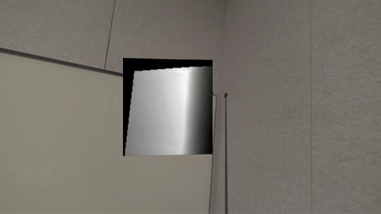
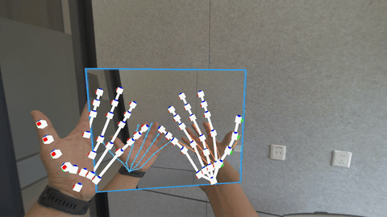
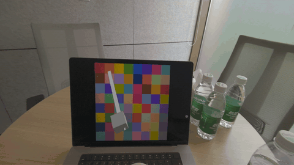
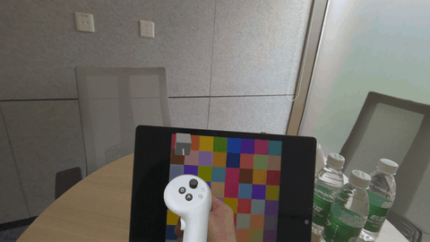
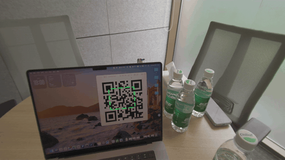

<div align="center">

# PICO Camera Pack Sample

**Templates and reference samples for PICO headsets, showing how to build AR/MR vision, tracking, and spatial interaction with PICO Camera Pack passthrough RGB camera access.**

</div>

<p align="center">
<strong>English</strong> | <a href="./README.zh-CN.md">中文</a>
</p>

***

> This project is based on the sample design from the open-source community project [QuestCameraKit (v81)](https://github.com/xrdevrob/QuestCameraKit/tree/v81) and adds PICO-developed samples to showcase PICO Camera Pack capabilities. QuestCameraKit comes from the Meta Passthrough Camera API ecosystem and covers scenarios such as color sampling and QR code tracking, making it an important reference for Quest MR developers. This project migrates those scenes to PICO through `PXR_CamTextureManager` and adds PICO-specific Camera Pack and environment depth samples.

# Contents

- [Adaptation Status Overview](#adaptation-status-overview)
- [PICO-Developed Samples](#pico-developed-samples)
- [QuestCameraKit-Based Samples](#questcamerakit-based-samples)
- [Quick Start](#quick-start)
- [Troubleshooting and Known Issues](#troubleshooting-and-known-issues)
- [Community Contribution References](#community-contribution-references)
- [News References](#news-references)
- [Acknowledgements](#acknowledgements)
- [License](#license)
- [Contact](#contact)

# Adaptation Status Overview

> **Status labels**
>
> - ✅ **Adapted**: Migrated to PICO Camera Pack (`PXR_CamTextureManager` and/or Environment Depth Extension) and runnable on device.
> - 🧩 **PICO-developed**: Built specifically around PICO capabilities.
>
> **Device notes**: `sparrow` and `swan` are target PICO headset devices. Environment depth capabilities require `swan`.

| # | Sample                                | Capabilities                                          | Status            | Devices                                                      |
| - | ------------------------------------- | ----------------------------------------------------- | ----------------- | ------------------------------------------------------------ |
| — | Environment Depth Extension (Preview) | Depth preview + environment depth raycast             | 🧩 PICO-developed | swan                                                         |
| — | HandJointsOverlay                     | Accurate hand skeleton overlay on camera frames, with frame sync and filtering | 🧩 PICO-developed | sparrow, swan                                                |
| — | PICOFeature                           | Video Seethrough / Occlusion / Camera Pack Visualizer | 🧩 PICO-developed | Video Seethrough / Visualizer: sparrow, swan; Occlusion: swan |
| 1 | ColorPicker                           | 3D-to-2D pixel mapping and color sampling             | ✅ Adapted        | sparrow (Manual), swan (Depth)                               |
| 2 | QRCodeTracking                        | ZXing single/multi-code detection + ray projection     | ✅ Adapted        | swan                                                         |

# PICO-Developed Samples

## 🧩 Environment Depth Extension (Preview)

- **Purpose**: Lets virtual rays interact with real physical surfaces through PICO environment depth.
- **Implementation**: `com.bytedance.pico.environmentdepthextension` extends PICO Unity (Swan) environment depth capabilities with depth preview, frame data access, and depth raycasting.
- **Current status**: 🧩 PICO-developed (Preview, not for production use)
- **Supported devices**: swan
- **Scene file**: [DepthPreviewRaycast.unity](file:///e:/CameraPack/UnityCameraPackSample/Unity-QuestVisionKit/Assets/Samples/PICO%20Environment%20Depth%20Extension%20\(Preview\)/0.5.0/Depth%20Preview%20%26%20Raycast/DepthPreviewRaycast.unity)

<details>
<summary>How to run</summary>

- Make sure the `com.bytedance.pico.environmentdepthextension` package is installed. It depends on `com.unity.burst`.
- Add `EnvironmentDepthDataAccess` to the XR Rig. It resolves the depth provider in `Awake` and broadcasts frame data through `DepthFrameReceived`.
- Add `EnvironmentDepthRaycaster`, which depends on `EnvironmentDepthDataAccess`, to raycast against environment depth.
- Build the `DepthPreviewRaycast` scene to a `swan` device.

```csharp
var raycaster = GetComponent<EnvironmentDepthRaycaster>();
var ray = new Ray(transform.position, transform.forward);
if (raycaster.Raycast(ray, out EnvironmentRaycastHit hit, maxDistance: 5f))
{
    // hit.Point, hit.Normal, hit.NormalConfidence, and hit.Distance are valid.
}
```

</details>



## 🧩 HandJointsOverlay

- **Purpose**: Draws the hand skeleton accurately on top of the PICO passthrough camera image, aligning hands and camera pixels.
- **Implementation**: This sample uses camera frame gating (`CameraFrameGate`) and timestamped history buffering (`TimedHandJointHistory`) to synchronize hand joint data with camera frames. Z-score filtering (`ZScoreJointFilter`) suppresses tracking jitter and outliers, while the built-in hand tracking restart policy (`HandTrackerRestartPolicy`) handles tracking loss. It projects 26 hand joints into the camera image and draws a skeleton overlay on a copy of the frame: joints are solid points, bones are solid lines, and left/right hands use different colors. Each frame outputs the composited texture through `TextureSkeletonPainter.ResultTexture`; to record the processed image, read `m_painter.ResultTexture` after `m_painter.Apply()` in `HandJointsCameraOverlay.LateUpdate`. Editor tests cover time synchronization, history interpolation, and border drawing.
- **Capabilities**: 3D-to-2D pixel mapping, camera frame and hand timestamp synchronization, Z-score outlier filtering, joint history interpolation, and camera image processing.
- **Current status**: 🧩 PICO-developed
- **Supported devices**: sparrow, swan
- **Scene file**: [HandJointsOverlayVisualizer.unity](file:///e:/CameraPack/UnityCameraPackSample/Unity-QuestVisionKit/Assets/Samples/3%20HandJointsOverlay/HandJointsOverlayVisualizer.unity)

<details>
<summary>How to run</summary>

- Open the `HandJointsOverlayVisualizer` scene.
- Make sure the scene is configured with `PXR_CamTextureManager`, `HandJointProvider`, and a display Quad.
- Optional Inspector settings:
  - `Smooth Joints`: Enables Z-score temporal filtering.
  - `Smoothing Window`: Filter window size. The default is 8 frames.
  - `Z Score Threshold`: Outlier threshold. The default is 2 sigma.
  - `Show Left Hand` / `Show Right Hand`: Toggles left/right hand display.
- Build and deploy to a PICO device, then place your hands in front of the headset to see the skeleton overlay.

</details>



## 🧩 PICOFeature

- **Purpose**: Provides sample scenes for PICO passthrough, environment depth occlusion, and basic Camera Pack features.
- **Implementation**: This group contains directly runnable scenes such as **PICO Video Seethrough**, **PICO Occlusion**, and **PICO Camera Pack Visualizer**. They verify passthrough rendering, occlusion materials, and basic Camera Pack texture visualization. **PICO Occlusion** supports only `swan` devices.
- **Current status**: 🧩 PICO-developed
- **Supported devices**: Video Seethrough / Camera Pack Visualizer support `sparrow` and `swan`; Occlusion supports only `swan`.
- **Scene files**: [PICO Video Seethrough.unity](file:///e:/CameraPack/UnityCameraPackSample/Unity-QuestVisionKit/Assets/Samples/PICOFeature/PICO%20Video%20Seethrough.unity) · [PICO Occlusion.unity](file:///e:/CameraPack/UnityCameraPackSample/Unity-QuestVisionKit/Assets/Samples/PICOFeature/PICO%20Occlusion.unity) · [PICO Camera Pack Visualizer.unity](file:///e:/CameraPack/UnityCameraPackSample/Unity-QuestVisionKit/Assets/Samples/PICOFeature/PICO%20Camera%20Pack%20Visualizer.unity)

# QuestCameraKit-Based Samples

## 1. 🎨 ColorPicker — ✅ Adapted

- **Purpose**: Maps a 3D point in space to a 2D image pixel and samples its color.
- **Implementation**: Supports two sampling modes. **Environment** mode uses the PICO-developed `EnvironmentDepthRaycaster` to compute where a ray hits a real surface, then projects that 3D point to RGB texture UVs for color sampling. This mode is based on environment depth and supports only `swan`. **Manual** mode samples a fixed point in front of the controller and can run on both `sparrow` and `swan`. The sampled color drives the cube material, with optional brightness correction.
- **Capabilities**: 3D-to-2D pixel mapping.
- **Current status**: ✅ Adapted, using `PXR_CamTextureManager` + `EnvironmentDepthRaycaster`.
- **Supported devices**: `sparrow` (Manual mode), `swan` (Environment / Depth mode).
- **Scene file**: [ColorPicker.unity](file:///e:/CameraPack/UnityCameraPackSample/Unity-QuestVisionKit/Assets/Samples/1%20ColorPicker/ColorPicker.unity)

<details>
<summary>How to run</summary>

- Open the `ColorPicker` scene and select the `SamplingMode` on the component: Environment or Manual.
- Environment mode requires `EnvironmentDepthRaycaster` and the Environment Depth Extension package, and supports only `swan`.
- Build to a PICO device, aim at a real surface, and press Trigger to sample color.

</details>

 

## 2. 📱 QRCodeTracking — ✅ Adapted

- **Purpose**: Detects and tracks QR codes in real time, then projects them into 3D space.
- **Implementation**: Uses [ZXing.Net](https://github.com/micjahn/ZXing.Net/) to detect QR codes. It supports single-code and multi-code modes, and uses PICO `EnvironmentDepthRaycaster` for CenterOnly and PerCorner placement modes. Detection code is controlled by the `ZXING_ENABLED` scripting define.
- **Capabilities**: ZXing.Net + single/multi-code detection + CenterOnly/PerCorner rays.
- **Current status**: ✅ Adapted, using `PXR_CamTextureManager` + `EnvironmentDepthRaycaster`, with a dependency on the Environment Depth Extension package.
- **Supported devices**: swan
- **Scene file**: [QRCodeTracking.unity](file:///e:/CameraPack/UnityCameraPackSample/Unity-QuestVisionKit/Assets/Samples/2%20QRCodeTracking/QRCodeTracking.unity)

<details>
<summary>How to run</summary>

- In the Unity Editor, open **PICO ▸ Camera Sample ▸ Configure Dependencies**. The panel shows the install status, source, target path, and purpose for optional dependencies.
- Click **Import / Configure All Dependencies** to import official Unity dependency samples and configure the ZXing library.
- Open the `QRCodeTracking` scene, then choose the detection mode (Single/Multiple) and ray mode (CenterOnly/PerCorner).
- Build to a `swan` device and aim at a QR code.

</details>



# Quick Start

## Requirements

- **PICO device**: A PICO headset (`sparrow` / `swan`) is required. Environment depth capabilities, including ColorPicker Environment mode, QRCodeTracking, Depth Extension, and Occlusion, require `swan`.
- **Unity**: Use `Unity 6000.3.13f1` (Unity 6).
- **Render pipeline**: Universal Render Pipeline (`com.unity.render-pipelines.universal@17.3.0`).
- **PICO Unity SDK**: Install PICO Unity Integration / XR SDK (`com.bytedance.pico.xr`, Swan).
- **XR Hands**: `com.unity.xr.hands@1.8.1`, required for hand joint tracking.
- **Camera Pack**: Provided by the PICO SDK through `ByteDance.PICO.CameraPack` and `PXR_CamTextureManager`.
- **Environment Depth Extension (Preview)**: `com.bytedance.pico.environmentdepthextension@0.5.0`, which depends on `com.unity.burst` and PICO `swan` environment depth capability.
- **Device testing**: The passthrough RGB camera is unavailable in the Editor or simulator. Test on a real device.
- **Permissions**: Grant headset camera permission on first launch.

## Installation

1. **Clone the repository:**
   ```
   git clone <this-repo-url>
   ```
2. **Configure the PICO Unity SDK:** This project references the PICO SDK (`com.bytedance.pico.xr`) through a local path in [Packages/manifest.json](file:///e:/CameraPack/UnityCameraPackSample/Unity-QuestVisionKit/Packages/manifest.json). Make sure the PICO SDK is located at `../PICO-Unity-SDK-6.0.0-20260729/XR`.
3. **Open the project:** Open `Unity-QuestVisionKit` with `Unity 6000.3.13f1`.
4. **Configure XR:** Enable PICO in *Project Settings ▸ XR Plug-in Management*, then grant camera permission on the device.
5. **Configure project dependencies:** After cloning and opening the project for the first time, run **PICO ▸ Camera Sample ▸ Configure Dependencies**. The configuration panel shows each optional dependency's install status, source, target path, and purpose. Click **Import / Configure All Dependencies** to import official dependency samples and install the ZXing library required by QRCodeTracking.

# Troubleshooting and Known Issues

- **QRCodeTracking cannot detect QR codes:** Run **Import / Configure All Dependencies** in **PICO ▸ Camera Sample ▸ Configure Dependencies**, and make sure the ZXing DLL exists and `ZXING_ENABLED` is defined.
- **Environment depth supports only swan:** ColorPicker Environment mode, QRCodeTracking, Depth Extension, and Occlusion all depend on environment depth and are available only on `swan`.
- **Hand skeleton and camera image are not synchronized or appear jittery:** Make sure `Smooth Joints` is enabled on `HandJointsCameraOverlay`, and check that `CameraFrameGate` and `TimedHandJointHistory` initialize correctly. If tracking loss continues, inspect logs from `HandTrackerRestartPolicy`.
- **No camera image in the Editor:** The passthrough RGB camera is available only on a real device. Build to a PICO headset.
- **Camera permission errors:** Make sure headset camera permission has been granted. Otherwise, `PXR_CamTextureManager` cannot start.

# Community Contribution References

The following references come from the upstream QuestCameraKit ecosystem and are kept as context and inspiration.

- **Tutorials**
  - **XR Dev Rob - XR AI Tutorials**: [YouTube](https://www.youtube.com/watch?v=1z3pcMJbnRA)
  - **Dilmer Valecillos**: [YouTube](https://www.youtube.com/watch?v=lhnuP6lJ_yY)
  - **Skarredghost**: [YouTube](https://www.youtube.com/watch?v=A2ZhJt-SIBU)
  - **FireDragonGameStudio**: [YouTube](https://www.youtube.com/watch?v=1R9yrXePJ40)
  - **xr masiso**: [YouTube](https://www.youtube.com/watch?v=FXFgkAmvpgo)
  - **Urals Technologies**: [YouTube playlist](https://www.youtube.com/playlist?list=PLU7W-ZU9OIiEanYEKtjyHQIoLrf0SflXx)
- **Environment understanding and reconstruction**
  - [Takashi Yoshinaga](https://x.com/Tks_Yoshinaga): [Convert images to colored point clouds](https://x.com/Tks_Yoshinaga/status/1900923909962133782)
  - [Alireza Bahremand](https://x.com/lirezaBahremand): [Feed Quest passthrough images into MAST3R-SLAM scene point cloud distribution](https://x.com/lirezaBahremand/status/1901665472069902772)
  - [うえださん](https://x.com/ueda406): [3D scanning](https://x.com/ueda406/status/1904771581102923942)
  - [Sander Sneek](https://www.linkedin.com/in/sandersneek/): [Mixed reality voxel demo](https://www.linkedin.com/feed/update/urn:li:activity:7312869115583414273/)
  - [Takashi Yoshinaga](https://x.com/Tks_Yoshinaga): [Quest real-time point cloud data](https://x.com/taka_yoshinaga/status/1910141763173712333)
  - [Bastion](https://x.com/BastionReality): [Sobel edge detection + passthrough camera + scan sound effects](https://x.com/BastionReality/status/1912358908804333844)
  - [Takashi Yoshinaga](https://x.com/Tks_Yoshinaga): [Map color images to point clouds with the depth API and passthrough camera](https://x.com/Tks_Yoshinaga/status/1916381129508012107)
- **Lighting and reflection estimation**
  - [pjchardt on Reddit](https://www.reddit.com/user/pjchardt/): [Lighting estimation prototype combining real lighting with virtual objects](https://www.reddit.com/r/OculusQuest/comments/1jlvy3o/meta_quest_cameraapi_prototype_combining_real/)
  - [Thomas Ratcliff](https://x.com/devtom7): [Dynamic reflection data generation](https://x.com/devtom7/status/1913667214399414659)
  - [Thomas Ratcliff](https://x.com/devtom7): [Camera-based reflection and lighting](https://x.com/devtom7/status/1913965819987366267)
- **Environment sampling**
  - [Christoph Spinger](https://www.linkedin.com/in/christoph-spinger-280621190/): [Chameleon color picker](https://www.linkedin.com/feed/update/urn:li:activity:7306688023843250176/)
  - [Sid Naik](https://www.linkedin.com/in/sidharthrnaik/): [Replicating indoor lighting](https://www.linkedin.com/posts/sidharthrnaik_augmentedreality-virtualreality-vr-activity-7307523483318566912-NpGr/)
  - [Markus Altenhofer](https://www.linkedin.com/in/markus-altenhofer-176453155/): [XR Minecraft with Meta Quest 3 depth sensor and ColorPicker](https://www.youtube.com/watch?v=CNoueOloXNo)
- **QR code tracking**
  - [Christoph Spinger](https://www.linkedin.com/in/christoph-spinger-280621190/): [QR code object tracking](https://www.linkedin.com/feed/update/urn:li:activity/7306652200418598912/)

# News References

- 2025-03-21 The Mysticle: [Quest major update introduction](https://www.youtube.com/watch?v=dG1rxxVDb9Y)
- 2025-03-18 Road to VR: [Meta releases Quest Camera Access for developers](https://www.roadtovr.com/meta-releases-quest-camera-access-for-developers-promising-even-more-immersive-mixed-reality-games/)
- 2025-03-17 MIXED Reality News: [Quest developers get new mixed reality API](https://mixed-news.com/en/meta-quest-3-passthrough-camera-api-experimental-release/)
- 2025-03-14 UploadVR: [Quest Passthrough Camera API released](https://www.uploadvr.com/quest-passthrough-camera-api-experimental-out-now/)

# Acknowledgements

- Thanks to **PICO** for providing Camera Pack, environment depth capabilities, and XR Hands support for the PICO-developed samples in this project.
- This project is based on **[QuestCameraKit](https://github.com/xrdevrob/QuestCameraKit/tree/v81)** by [Roberto Coviello (xrdevrob)](https://x.com/xrdevrob). The original sample designs and scenes come from that project.
- Thanks to **Meta** for providing the Passthrough Camera API and [Passthrough Camera API Samples](https://github.com/oculus-samples/Unity-PassthroughCameraApiSamples/).
- Thanks to **[Michael Jahn](https://github.com/micjahn/ZXing.Net/)** for the ZXing.Net library used by the QR code tracking sample.

# License

This project is licensed under the MIT License. See the LICENSE file for details. The original QuestCameraKit project is also licensed under MIT; keep the upstream acknowledgements when reusing related samples.

# Contact

For PICO-related issues, use PICO developer channels. For questions about the upstream QuestCameraKit samples, contact the original author Roberto Coviello ([X](https://x.com/xrdevrob) / [LinkedIn](https://www.linkedin.com/in/robertocoviello/)).

***

Happy coding, and keep exploring what PICO Camera Pack can do.

