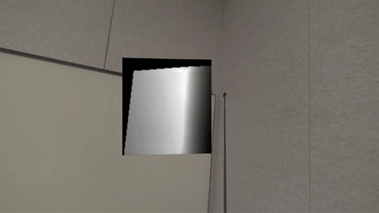
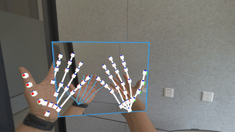
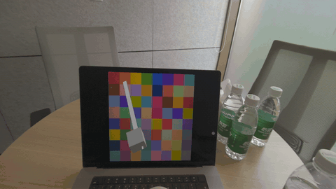
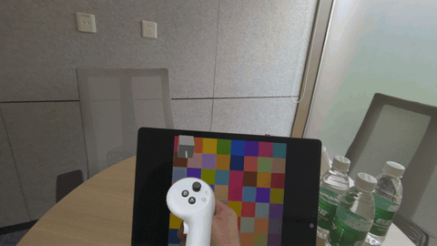
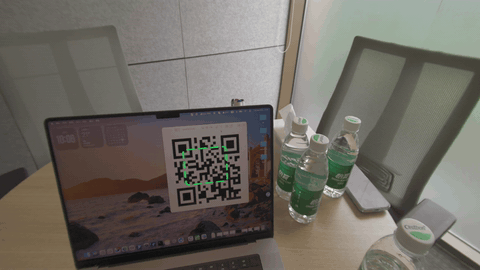

<div align="center">

# PICO Camera Pack Sample

**一套面向 PICO 头显的模板与参考示例，展示如何使用 PICO Camera Pack（透视 RGB 相机访问能力）构建 AR/MR 视觉、追踪与空间交互。**

</div>

<p align="center">
<a href="./README.md">English</a> | <strong>中文</strong>
</p>

***

> 本工程基于开源社区项目 [QuestCameraKit（v81）](https://github.com/xrdevrob/QuestCameraKit/tree/v81) 的 Sample 设计，并补充 PICO 自研 Sample，集中展示 PICO Camera Pack 能力。QuestCameraKit 源自 Meta Passthrough Camera API 生态，覆盖颜色采样、二维码追踪等场景，是 Quest MR 开发者的重要参考。本工程通过 `PXR_CamTextureManager` 将场景迁移到 PICO，同时加入 PICO 专属的 Camera Pack 与环境深度示例。

# 目录

- [适配状态总览](#适配状态总览)
- [PICO 自研 Sample](#pico-自研-sample)
- [QuestCameraKit 系 Sample](#questcamerakit-系-sample)
- [快速开始](#快速开始)
- [故障排查与已知问题](#故障排查与已知问题)
- [社区贡献参考](#社区贡献参考)
- [新闻参考](#新闻参考)
- [致谢](#致谢)
- [许可证](#许可证)
- [联系方式](#联系方式)

# 适配状态总览

> **状态说明**
>
> - ✅ **已适配**：已迁移到 PICO Camera Pack（`PXR_CamTextureManager` 和/或 Environment Depth Extension），可在真机运行。
> - 🧩 **自研**：围绕 PICO 能力专门开发。
>
> **设备说明**：`sparrow` 与 `swan` 为 PICO 头显目标设备；环境深度相关能力需 `swan`。

| # | Sample                                | 能力点                                                   | 状态       | 设备                                                         |
| - | ------------------------------------- | ----------------------------------------------------- | -------- | ---------------------------------------------------------- |
| — | Environment Depth Extension (Preview) | 深度预览 + 环境深度射线检测                                       | 🧩 自研    | swan                                                       |
| — | HandJointsOverlay                     | 手部骨架精准叠加到相机画面（含帧同步与滤波）                               | 🧩 自研    | sparrow, swan                                              |
| — | PICOFeature                           | Video Seethrough / Occlusion / Camera Pack Visualizer | 🧩 自研    | Video Seethrough / Visualizer：sparrow, swan；Occlusion：swan |
| 1 | ColorPicker                           | 3D→2D 像素映射与取色                                         | ✅ 已适配    | sparrow（Manual），swan（Depth）                                |
| 2 | QRCodeTracking                        | ZXing 单/多码检测 + 射线投影                                   | ✅ 已适配    | swan                                                       |

# PICO 自研 Sample

## 🧩 Environment Depth Extension (Preview)

- **功能定位**：让虚拟射线借助 PICO 环境深度与真实物理表面交互。
- **实现说明**：`com.bytedance.pico.environmentdepthextension` 基于 PICO Unity（Swan）环境深度能力扩展出深度预览、帧数据访问与深度射线检测。
- **当前状态**：🧩 自研（Preview，不用于生产）
- **支持设备**：swan
- **场景文件**：[DepthPreviewRaycast.unity](file:///e:/CameraPack/UnityCameraPackSample/Unity-QuestVisionKit/Assets/Samples/PICO%20Environment%20Depth%20Extension%20\(Preview\)/0.5.0/Depth%20Preview%20%26%20Raycast/DepthPreviewRaycast.unity)

<details>
<summary>运行方式</summary>

- 确认已安装 `com.bytedance.pico.environmentdepthextension` 包（依赖 `com.unity.burst`）。
- 在 XR Rig 上添加 `EnvironmentDepthDataAccess`，它会在 `Awake` 解析深度 Provider，并通过 `DepthFrameReceived` 广播帧数据。
- 添加 `EnvironmentDepthRaycaster`（依赖 `EnvironmentDepthDataAccess`）即可对环境深度做射线检测。
- 将 `DepthPreviewRaycast` 场景构建到 `swan` 设备运行。

```csharp
var raycaster = GetComponent<EnvironmentDepthRaycaster>();
var ray = new Ray(transform.position, transform.forward);
if (raycaster.Raycast(ray, out EnvironmentRaycastHit hit, maxDistance: 5f))
{
    // hit.Point, hit.Normal, hit.NormalConfidence, and hit.Distance are valid.
}
```

</details>



## 🧩 HandJointsOverlay

- **功能定位**：把手部骨架精准绘制到 PICO 透视相机画面上，实现手与相机画面的像素级对齐。
- **实现说明**：该 Sample 采用相机帧门控（CameraFrameGate）与时间戳历史缓冲（TimedHandJointHistory）确保手部关节数据与相机帧精准同步；通过 Z-score 滤波（ZScoreJointFilter）抑制追踪抖动与跳点；内置手部追踪自动重启策略（HandTrackerRestartPolicy）应对追踪丢失。将 26 个手部关节投影到相机画面，并在画面副本上绘制骨架叠加层：关节为实心点，骨骼为实线，左右手使用不同颜色。每帧都会输出合成纹理 `TextureSkeletonPainter.ResultTexture`；如需录制处理后的画面，可在 `HandJointsCameraOverlay.LateUpdate` 中 `m_painter.Apply()` 之后读取 `m_painter.ResultTexture`。附带 Editor 单元测试覆盖时间同步、历史插值与边框绘制。
- **能力点**：3D→2D 像素映射、相机帧-手部时间戳同步、Z-score 异常值滤波、关节历史插值、相机图像处理。
- **当前状态**：🧩 自研
- **支持设备**：sparrow, swan
- **场景文件**：[HandJointsOverlayVisualizer.unity](file:///e:/CameraPack/UnityCameraPackSample/Unity-QuestVisionKit/Assets/Samples/3%20HandJointsOverlay/HandJointsOverlayVisualizer.unity)

<details>
<summary>运行方式</summary>

- 打开 `HandJointsOverlayVisualizer` 场景。
- 确认场景中已配置 `PXR_CamTextureManager`、`HandJointProvider` 以及用于显示的 Quad。
- 可在 Inspector 中调整：
  - `Smooth Joints`：启用 Z-score 时间滤波
  - `Smoothing Window`：滤波窗口大小（默认 8 帧）
  - `Z Score Threshold`：异常值阈值（默认 2σ）
  - `Show Left Hand` / `Show Right Hand`：左右手显示开关
- 构建部署到 PICO 设备，把手放到头显前即可看到叠加的骨架。

</details>



## 🧩 PICOFeature

- **功能定位**：展示 PICO 透视，环境深度遮挡剔除和 Camera Pack 基础能力的示例场景。
- **实现说明**：该分组包含 **PICO Video Seethrough**、**PICO Occlusion**、**PICO Camera Pack Visualizer** 等可直接运行的场景，用于验证透视渲染、遮挡材质与基础 Camera Pack 纹理可视化。**PICO Occlusion** 仅支持 `swan` 设备。
- **当前状态**：🧩 自研
- **支持设备**：Video Seethrough / Camera Pack Visualizer 支持 `sparrow` 与 `swan`；Occlusion 仅支持 `swan`。
- **场景文件**：[PICO Video Seethrough.unity](file:///e:/CameraPack/UnityCameraPackSample/Unity-QuestVisionKit/Assets/Samples/PICOFeature/PICO%20Video%20Seethrough.unity) · [PICO Occlusion.unity](file:///e:/CameraPack/UnityCameraPackSample/Unity-QuestVisionKit/Assets/Samples/PICOFeature/PICO%20Occlusion.unity) · [PICO Camera Pack Visualizer.unity](file:///e:/CameraPack/UnityCameraPackSample/Unity-QuestVisionKit/Assets/Samples/PICOFeature/PICO%20Camera%20Pack%20Visualizer.unity)

# QuestCameraKit 系 Sample

## 1. 🎨 ColorPicker — ✅ 已适配

- **功能定位**：把空间中的 3D 点映射到 2D 图像像素并采样颜色。
- **实现说明**：支持两种采样模式：**Environment** 模式使用 PICO 自研 `EnvironmentDepthRaycaster` 计算射线与真实表面的交点，再将 3D 点投影到 RGB 纹理 UV 上进行取色（基于环境深度，仅 `swan`）；**Manual** 模式在手柄前方固定点取色，可运行在 `sparrow` 与 `swan`。采样结果用于驱动 cube 材质，并支持可选的亮度校正。
- **能力点**：3D→2D 像素映射。
- **当前状态**：✅ 已适配，使用 `PXR_CamTextureManager` + `EnvironmentDepthRaycaster`。
- **支持设备**：`sparrow`（Manual 模式），`swan`（Environment / Depth 模式）。
- **场景文件**：[ColorPicker.unity](file:///e:/CameraPack/UnityCameraPackSample/Unity-QuestVisionKit/Assets/Samples/1%20ColorPicker/ColorPicker.unity)

<details>
<summary>运行方式</summary>

- 打开 `ColorPicker` 场景，在组件上选择 `SamplingMode`（Environment 或 Manual）。
- Environment 模式需 `EnvironmentDepthRaycaster` 与 Environment Depth Extension 包（仅 `swan`）。
- 构建到 PICO 设备，对准真实表面，按 Trigger 取色。

</details>

 

## 2. 📱 QRCodeTracking — ✅ 已适配

- **功能定位**：实时检测追踪二维码并投影到 3D 空间。
- **实现说明**：使用 [ZXing.Net](https://github.com/micjahn/ZXing.Net/) 检测二维码，支持单码/多码模式，并通过 PICO `EnvironmentDepthRaycaster` 提供 CenterOnly/PerCorner 两种空间放置方式；检测代码由 `ZXING_ENABLED` 宏控制。
- **能力点**：ZXing.Net + 单/多码 + CenterOnly/PerCorner 射线。
- **当前状态**：✅ 已适配，使用 `PXR_CamTextureManager` + `EnvironmentDepthRaycaster`，依赖 Environment Depth Extension 包。
- **支持设备**：swan
- **场景文件**：[QRCodeTracking.unity](file:///e:/CameraPack/UnityCameraPackSample/Unity-QuestVisionKit/Assets/Samples/2%20QRCodeTracking/QRCodeTracking.unity)

<details>
<summary>运行方式</summary>

- 在 Unity Editor 中，通过 **PICO ▸ Camera Sample ▸ Configure Dependencies** 打开配置页；该面板会列出可选依赖的安装状态、来源、目标路径与用途说明。
- 点击 **Import / Configure All Dependencies** 一键导入 Unity 官方依赖 Sample 并配置 ZXing 库。
- 打开 `QRCodeTracking` 场景，选择检测模式（Single/Multiple）与射线模式（CenterOnly/PerCorner）。
- 构建到 `swan` 设备并对准二维码。

</details>



# 快速开始

## 前置条件

- **PICO 设备**：需要一台 PICO 头显（`sparrow` / `swan`）；环境深度相关能力（包括 ColorPicker 的 Environment 模式、QRCodeTracking、Depth Extension、Occlusion）需 `swan`。
- **Unity**：使用 `Unity 6000.3.13f1`（Unity 6）。
- **渲染管线**：Universal Render Pipeline（`com.unity.render-pipelines.universal@17.3.0`）。
- **PICO Unity SDK**：需安装 PICO Unity Integration / XR SDK（`com.bytedance.pico.xr`，Swan）。
- **XR Hands**：`com.unity.xr.hands@1.8.1`（手部关节追踪依赖）。
- **Camera Pack**：由 PICO SDK 通过 `ByteDance.PICO.CameraPack` 与 `PXR_CamTextureManager` 提供。
- **Environment Depth Extension (Preview)**：`com.bytedance.pico.environmentdepthextension@0.5.0`（依赖 `com.unity.burst`，swan 环境深度能力依赖）。
- **真机要求**：透视 RGB 相机在 Editor 或模拟器中不可用，必须使用真机测试。
- **权限要求**：首次运行需授予头显相机权限。

## 安装

1. **克隆仓库：**
   ```
   git clone <this-repo-url>
   ```
2. **配置 PICO Unity SDK：** 本工程在 [Packages/manifest.json](file:///e:/CameraPack/UnityCameraPackSample/Unity-QuestVisionKit/Packages/manifest.json) 中通过本地路径引用 PICO SDK（`com.bytedance.pico.xr`），请确保 PICO SDK 位于 `../PICO-Unity-SDK-6.0.0-20260729/XR`。
3. **打开工程：** 使用 `Unity 6000.3.13f1` 打开 `Unity-QuestVisionKit`。
4. **配置 XR：** 在 *Project Settings ▸ XR Plug-in Management* 中启用 PICO，并在设备侧授予相机权限。
5. **配置工程依赖：** 克隆工程并首次打开后，需要执行 **PICO ▸ Camera Sample ▸ Configure Dependencies** 来配置工程依赖。配置页会展示每个可选依赖的安装状态、来源、目标路径与用途说明；点击 **Import / Configure All Dependencies** 可导入官方依赖 Sample，并安装 QRCodeTracking 所需的 ZXing 库。

# 故障排查与已知问题

- **QRCodeTracking 无法检测二维码：** 执行 **PICO ▸ Camera Sample ▸ Configure Dependencies** 中的 **Import / Configure All Dependencies**，确保 ZXing DLL 存在且 `ZXING_ENABLED` 已定义。
- **环境深度仅支持 swan：** ColorPicker 的 Environment 模式、QRCodeTracking、Depth Extension 与 Occlusion 均依赖环境深度，仅 `swan` 可用。
- **手部骨架与相机画面不同步/抖动：** 确认 `HandJointsCameraOverlay` 上 `Smooth Joints` 已启用，并检查 `CameraFrameGate` 与 `TimedHandJointHistory` 组件是否正常初始化；如持续追踪丢失可查看日志中 `HandTrackerRestartPolicy` 的重启记录。
- **Editor 中没有相机画面：** 透视 RGB 相机仅真机可用，请构建到 PICO 头显运行。
- **相机权限异常：** 请确认已授予头显相机权限，否则 `PXR_CamTextureManager` 无法启动。

# 社区贡献参考

以下内容来自上游 QuestCameraKit 生态，作为参考与灵感保留。

- **教程**
  - **XR Dev Rob - XR AI Tutorials**：[YouTube](https://www.youtube.com/watch?v=1z3pcMJbnRA)
  - **Dilmer Valecillos**：[YouTube](https://www.youtube.com/watch?v=lhnuP6lJ_yY)
  - **Skarredghost**：[YouTube](https://www.youtube.com/watch?v=A2ZhJt-SIBU)
  - **FireDragonGameStudio**：[YouTube](https://www.youtube.com/watch?v=1R9yrXePJ40)
  - **xr masiso**：[YouTube](https://www.youtube.com/watch?v=FXFgkAmvpgo)
  - **Urals Technologies**：[YouTube 播放列表](https://www.youtube.com/playlist?list=PLU7W-ZU9OIiEanYEKtjyHQIoLrf0SflXx)
- **环境理解与重建**
  - [Takashi Yoshinaga](https://x.com/Tks_Yoshinaga)：[将图像转换为彩色点云](https://x.com/Tks_Yoshinaga/status/1900923909962133782)
  - [Alireza Bahremand](https://x.com/lirezaBahremand)：[将 Quest 透视图像接入 MAST3R-SLAM 场景点云分发](https://x.com/lirezaBahremand/status/1901665472069902772)
  - [うえださん](https://x.com/ueda406)：[3D 扫描](https://x.com/ueda406/status/1904771581102923942)
  - [Sander Sneek](https://www.linkedin.com/in/sandersneek/)：[混合现实体素演示](https://www.linkedin.com/feed/update/urn:li:activity:7312869115583414273/)
  - [Takashi Yoshinaga](https://x.com/Tks_Yoshinaga)：[Quest 实时点云数据](https://x.com/taka_yoshinaga/status/1910141763173712333)
  - [Bastion](https://x.com/BastionReality)：[Sobel 边缘检测 + 透视相机 + 扫描音效](https://x.com/BastionReality/status/1912358908804333844)
  - [Takashi Yoshinaga](https://x.com/Tks_Yoshinaga)：[结合深度 API 与透视相机为点云映射彩色图像](https://x.com/Tks_Yoshinaga/status/1916381129508012107)
- **光照与反射估计**
  - [pjchardt on Reddit](https://www.reddit.com/user/pjchardt/)：[结合真实光照与虚拟物体的光照估计原型](https://www.reddit.com/r/OculusQuest/comments/1jlvy3o/meta_quest_cameraapi_prototype_combining_real/)
  - [Thomas Ratcliff](https://x.com/devtom7)：[动态反射数据生成](https://x.com/devtom7/status/1913667214399414659)
  - [Thomas Ratcliff](https://x.com/devtom7)：[基于相机的反射与光照](https://x.com/devtom7/status/1913965819987366267)
- **环境采样**
  - [Christoph Spinger](https://www.linkedin.com/in/christoph-spinger-280621190/)：[变色龙取色器](https://www.linkedin.com/feed/update/urn:li:activity:7306688023843250176/)
  - [Sid Naik](https://www.linkedin.com/in/sidharthrnaik/)：[复制室内光照效果](https://www.linkedin.com/posts/sidharthrnaik_augmentedreality-virtualreality-vr-activity-7307523483318566912-NpGr/)
  - [Markus Altenhofer](https://www.linkedin.com/in/markus-altenhofer-176453155/)：[结合 Meta Quest 3 深度传感器与 ColorPicker 的 XR Minecraft](https://www.youtube.com/watch?v=CNoueOloXNo)
- **二维码追踪**
  - [Christoph Spinger](https://www.linkedin.com/in/christoph-spinger-280621190/)：[二维码物体追踪](https://www.linkedin.com/feed/update/urn:li:activity/7306652200418598912/)

# 新闻参考

- 2025-03-21 The Mysticle：[Quest 重要更新介绍](https://www.youtube.com/watch?v=dG1rxxVDb9Y)
- 2025-03-18 Road to VR：[Meta 向开发者发布 Quest Camera Access](https://www.roadtovr.com/meta-releases-quest-camera-access-for-developers-promising-even-more-immersive-mixed-reality-games/)
- 2025-03-17 MIXED Reality News：[Quest 开发者获得新的混合现实 API](https://mixed-news.com/en/meta-quest-3-passthrough-camera-api-experimental-release/)
- 2025-03-14 UploadVR：[Quest Passthrough Camera API 发布](https://www.uploadvr.com/quest-passthrough-camera-api-experimental-out-now/)

# 致谢

- 感谢 **PICO** 提供 Camera Pack、环境深度能力与 XR Hands 支持，支撑本工程的 PICO 自研 Sample。
- 本工程基于 [Roberto Coviello (xrdevrob)](https://x.com/xrdevrob) 的 **[QuestCameraKit](https://github.com/xrdevrob/QuestCameraKit/tree/v81)**，原始 Sample 设计与场景源自该项目。
- 感谢 **Meta** 提供 Passthrough Camera API 与 [Passthrough Camera API Samples](https://github.com/oculus-samples/Unity-PassthroughCameraApiSamples/)。
- 感谢 **[Michael Jahn](https://github.com/micjahn/ZXing.Net/)** 提供二维码追踪 Sample 使用的 ZXing.Net 库。

# 许可证

本项目采用 MIT 许可证，详见 LICENSE 文件。原 QuestCameraKit 同样采用 MIT 许可证，复用相关 Sample 时请保留上游致谢。

# 联系方式

PICO 相关问题请通过 PICO 开发者渠道反馈；关于上游 QuestCameraKit Sample 的问题，可联系原作者 Roberto Coviello（[X](https://x.com/xrdevrob) / [LinkedIn](https://www.linkedin.com/in/robertocoviello/)）。

***

祝编码愉快，尽情探索 PICO Camera Pack 的更多可能！

