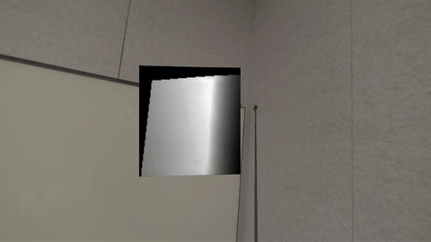
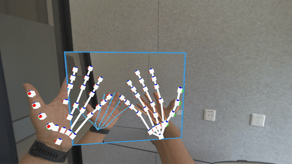
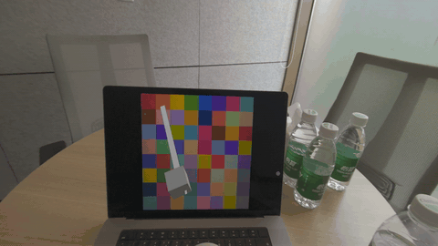
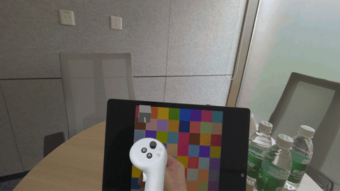
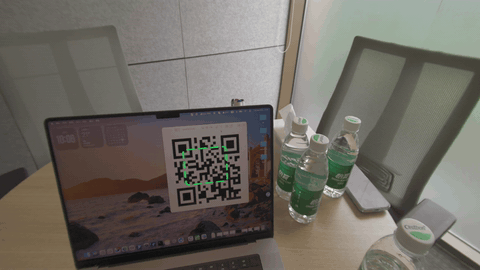

# PICO Camera Pack 示例

PICO Camera Pack 示例是面向开发者提供的技术示例项目，展示了如何基于 **PICO Camera Pack**（透视 RGB 相机访问能力）与 **Environment Depth Extension**（环境深度扩展）构建 AR/MR 视觉感知、空间追踪与交互应用。你可以在示例中体验环境深度射线检测、手部骨架叠加、相机取色、二维码追踪等功能场景。

该示例基于开源社区项目 [QuestCameraKit（v81）](https://github.com/xrdevrob/QuestCameraKit/tree/v81) 的 Sample 设计，通过 `PXR_CamTextureManager` 将可用场景迁移适配至 PICO 平台，并补充了多个 PICO 自研 Sample，集中展示 PICO Camera Pack 的核心能力。

## 开发环境

- Unity 编辑器版本：`Unity 6000.3.13f1`（Unity 6）
- 渲染管线：通用渲染管线（URP），`com.unity.render-pipelines.universal@17.3.0`
- PICO Unity SDK：PICO Unity Integration / XR SDK（`com.bytedance.pico.xr`，Project Swan）
- Camera Pack：由 PICO SDK 通过 `ByteDance.PICO.CameraPack` 命名空间与 `PXR_CamTextureManager` 组件提供
- 环境深度扩展（Preview）：`com.bytedance.pico.environmentdepthextension@0.5.0`（依赖 `com.unity.burst`）
- 输入系统：`com.unity.inputsystem@1.19.0`
- 图形 API：Vulkan
- PICO 设备型号：`sparrow` 与 `swan`

> **设备说明**
>
> - 透视 RGB 相机能力：`sparrow` 与 `swan` 均支持。
> - 环境深度（Environment Depth）能力：仅 `swan` 支持。因此依赖环境深度的场景（Environment Depth Extension、ColorPicker 的 Environment 模式、QRCodeTracking）需在 `swan` 设备上运行。

## 工程配置

| 配置项 | 说明 |
|---|---|
| 立体渲染模式（Stereo Rendering Mode） | Multiview |
| 图形 API | Vulkan（不支持 OpenGL） |
| 脚本后端（Scripting Backend） | IL2CPP |
| 目标架构（Target Architecture） | ARM64 |
| 渲染管线 | 通用渲染管线（URP 17.3.0） |
| 相机纹理管理 | `PXR_CamTextureManager` |
| 环境深度 | `com.bytedance.pico.environmentdepthextension@0.5.0` |

> **重要提示**：透视 RGB 相机功能在 Unity 编辑器或模拟器中不可用，必须打包至真机进行体验。首次启动示例时，需在设备端授予相机权限。

## GitHub 仓库

你可以克隆示例项目仓库，查看源代码脚本、场景文件、艺术资源等。

获取公开发布的源码后，请使用 `Unity 6000.3.13f1` 打开工程根目录下的 `Unity-QuestVisionKit` 目录。

> **配置 PICO Unity SDK**：本工程在 `Packages/manifest.json` 中通过本地路径引用 PICO SDK（`com.bytedance.pico.xr`），克隆后请将该路径修改为你本地的 PICO Unity SDK 位置或对应的包源地址。
>
> **配置依赖 Sample**：首次打开工程时，编辑器会提示打开 PICO Camera Pack 配置页。也可以手动通过 **PICO ▸ Camera Sample ▸ Configure Dependencies** 打开配置页，点击 **Import / Configure All Dependencies** 一键导入 Unity 官方依赖 Sample，并安装 QRCodeTracking 所需的 ZXing 库。

## 示例场景说明

示例分为 **PICO 自研 Sample** 与 **QuestCameraKit 系 Sample** 两类。所有场景位于工程的 `Unity-QuestVisionKit/Assets/Samples/` 目录下，可对单独场景进行打包体验。

### 适配状态说明

| 状态 | 含义 |
|---|---|
| ✅ 已适配 | 已迁移到 PICO Camera Pack（`PXR_CamTextureManager` 和/或 Environment Depth Extension），可在真机直接运行。 |
| 🧩 自研 | 围绕 PICO 平台能力专门开发。 |

### PICO 自研 Sample

| 场景 | 能力点 | 状态 | 设备 |
|---|---|---|---|
| Environment Depth Extension (Preview) | 深度预览 + 环境深度射线检测 | 🧩 自研 | swan |
| HandJointsOverlay | 手部骨架叠加到相机画面 | 🧩 自研 | sparrow, swan |
| PICOFeature | 视频透视 / 遮挡 / Camera Pack 可视化 | 🧩 自研 | 视频透视 / 可视化：sparrow, swan；遮挡：swan |

**Environment Depth Extension (Preview)**

借助 PICO 环境深度能力，让虚拟射线与真实物理表面进行交互。扩展包 `com.bytedance.pico.environmentdepthextension` 在 PICO Unity（Swan）环境深度能力之上，提供深度预览、帧数据访问与深度射线检测。运行链路分为三层：`IDepthSourceProvider` 接入逐帧深度纹理数组；`EnvironmentDepthDataAccess` 完成降采样与线性米制深度转换；`EnvironmentDepthRaycaster` 执行纹理空间 DDA 步进、双眼选择、遮挡分类与法线重建，对外暴露 `Raycast(...) → EnvironmentRaycastHit` 接口。

```csharp
var raycaster = GetComponent<EnvironmentDepthRaycaster>();
var ray = new Ray(transform.position, transform.forward);
if (raycaster.Raycast(ray, out EnvironmentRaycastHit hit, maxDistance: 5f))
{
    // hit.Point, hit.Normal, hit.NormalConfidence, hit.Distance are valid.
}
```



**HandJointsOverlay**

将 26 个手部关节点投影到相机画面，在画面副本上绘制骨架叠加层：关节显示为实心圆点，骨骼显示为实线，左右手使用不同颜色区分。可选的时序 Z-score 滤波可降低追踪抖动。每帧输出合成纹理 `TextureSkeletonPainter.ResultTexture`。



**PICOFeature**

包含 **PICO Video Seethrough**（视频透视）、**PICO Occlusion**（遮挡）、**PICO Camera Pack Visualizer**（Camera Pack 可视化）三个即开即用场景，分别用于验证透视渲染、遮挡材质与基础 Camera Pack 纹理可视化。其中遮挡（Occlusion）依赖仅 `swan` 支持的环境深度能力。

### QuestCameraKit 系 Sample

| # | 场景 | 能力点 | 状态 | 设备 |
|---|---|---|---|---|
| 1 | ColorPicker | 3D→2D 像素映射与取色 | ✅ 已适配 | sparrow（Manual），swan（Environment） |
| 3 | QRCodeTracking | ZXing 单/多码检测 + 射线投影 | ✅ 已适配 | swan |

**1. ColorPicker（取色器）**

将空间中的 3D 点映射到 2D 图像像素坐标并采样颜色，支持两种采样模式：**Environment** 模式使用 `EnvironmentDepthRaycaster` 计算射线与真实表面的交点（基于环境深度，仅 swan）；**Manual** 模式在手柄前方固定距离处取色（sparrow 与 swan 均可）。采样结果用于驱动 Cube 材质颜色。

| Environment 模式 | Manual 模式 |
|---|---|
|  |  |

**3. QRCodeTracking（二维码追踪）**

使用 [ZXing.Net](https://github.com/micjahn/ZXing.Net/) 进行二维码检测，支持单码/多码两种模式，并通过 `EnvironmentDepthRaycaster` 提供 CenterOnly（中心点）和 PerCorner（四角点）两种空间放置射线策略。检测代码由 `ZXING_ENABLED` 编译宏控制。



## 体验流程

1. 使用 USB 数据线连接电脑和 PICO 设备。

2. 在 Unity 编辑器中打开 `Unity-QuestVisionKit` 工程，在 *Project Settings ▸ XR Plug-in Management* 中启用 PICO Loader。

3. 选择需要体验的场景（例如 `DepthPreviewRaycast.unity`），在 *Build Settings* 中将其加入 *Scenes In Build*。

4. 切换平台至 Android，连接设备后点击 *Build And Run* 打包并安装至 PICO 设备。你也可以使用以下 ADB 命令安装已生成的 APK：

   ```
   adb install {APK 文件路径.apk}
   ```

5. 在设备上首次启动示例时，授予相机权限。

6. 体验场景内容：

   | 场景 | 体验说明 |
   |---|---|
   | Environment Depth Extension | 将头显对准真实表面，观察虚拟射线与环境深度的交互命中点。 |
   | HandJointsOverlay | 将双手放到头显前方，即可看到叠加在相机画面上的手部骨架。 |
   | PICOFeature | 体验视频透视、遮挡材质与 Camera Pack 纹理可视化。 |
   | ColorPicker | 对准真实表面按下 Trigger 键取色，采样颜色将驱动 Cube 材质。 |
   | QRCodeTracking | 将头显对准二维码，观察其被检测并投影到 3D 空间。 |

## 依赖配置

工程不再直接提交 Unity 官方 Sample 目录。运行前需在 Unity 编辑器中完成一次依赖配置：

1. 打开 **PICO ▸ Camera Sample ▸ Configure Dependencies**。
2. 点击 **Import / Configure All Dependencies**。
3. 配置页会导入 XR Hands HandVisualizer、XR Interaction Toolkit Starter Assets，并安装 ZXing.Net 到 QRCodeTracking 的 Plugins 目录。
4. 打开 `QRCodeTracking` 场景，选择检测模式（Single/Multiple）与射线模式（CenterOnly/PerCorner）。
5. 构建到 `swan` 设备并对准二维码。

## 故障排查与已知问题

| 问题 | 解决方案 |
|---|---|
| 编辑器中无相机画面 | 透视 RGB 相机仅真机可用，请打包部署到 PICO 头显运行。 |
| `PXR_CamTextureManager` 启动失败 | 确认已在设备系统设置中授予头显相机权限，未授权时相机纹理无法获取。 |
| 环境深度场景在 sparrow 上无法运行 | Environment Depth Extension、ColorPicker Environment 模式、QRCodeTracking 均依赖环境深度能力，仅 `swan` 设备支持。 |
| QRCodeTracking 无法检测二维码 | 执行 **PICO ▸ Camera Sample ▸ Configure Dependencies** 中的 **Import / Configure All Dependencies**，确保 ZXing DLL 已导入且 `ZXING_ENABLED` 宏已定义。 |

## 致谢

- 感谢 **PICO** 提供 Camera Pack 与环境深度能力，支撑本工程中 PICO 自研 Sample 的实现。
- 本工程基于 [Roberto Coviello (xrdevrob)](https://x.com/xrdevrob) 的 [QuestCameraKit](https://github.com/xrdevrob/QuestCameraKit/tree/v81) 开发，原始 Sample 设计与场景均源自该项目。
- 感谢 [Michael Jahn](https://github.com/micjahn/ZXing.Net/) 提供的 ZXing.Net 库。

本项目采用 MIT 许可证，详见 LICENSE 文件。
